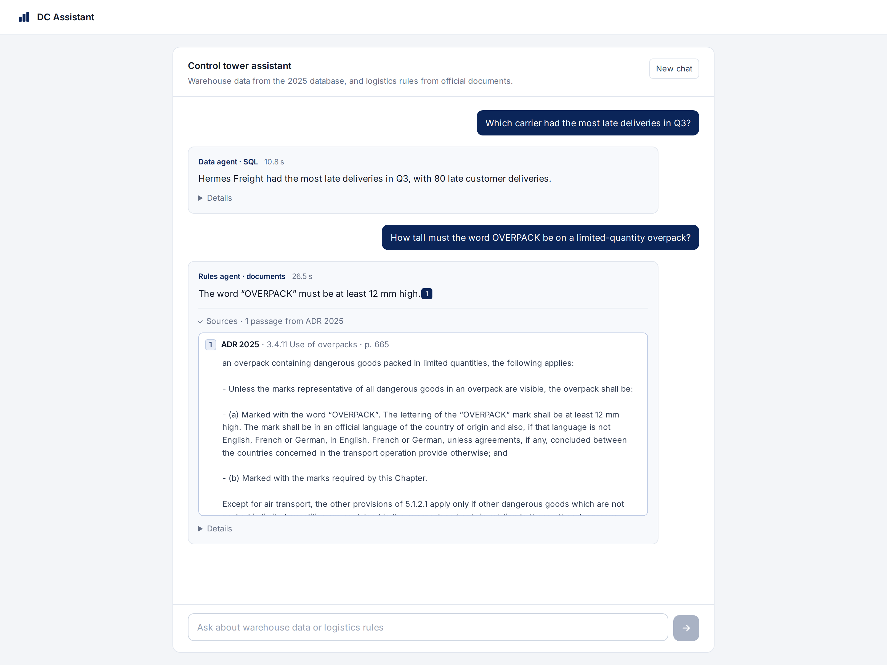
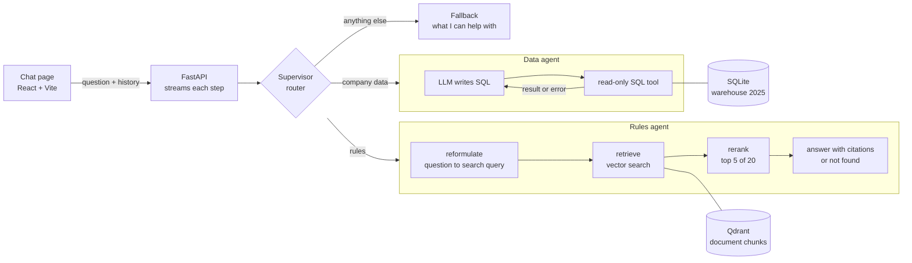

# DC AI Assistant

[](https://github.com/nboumpari/dc-ai-assistant/actions/workflows/ci.yml)


**A control tower assistant for an FMCG manufacturer that answers warehouse questions
from the company's own database and rule questions from the official documents, and
always shows which one it used.**

Planners in a distribution control tower ask two very different kinds of question all
day: *how many pallets did we ship from Athens in June?* and *how tall must the word
OVERPACK be on a limited-quantity overpack?* The first can only be answered from the
company's data, the second only from the rules, and an assistant that blurs the two
invents numbers or invents rules. This project keeps them apart. A supervisor sends
each question to a text-to-SQL agent or to a retrieval agent over the regulations, and
every part is measured on its own, on questions it was never tuned on, before it is
trusted.



<sub>A data question answered by the data agent, then a rules question answered by the
rules agent from ADR 2025. Each number in a rules answer opens the passage it cites.</sub>

## Highlights

- **Two specialists and a router.** A LangGraph supervisor sends every message to the
  data agent, the rules agent or a fallback for greetings and unrelated topics. It never
  answers a question itself and never merges two answers. On 38 questions it had not
  seen, it routed all 114 runs correctly.
- **SQL that cannot do harm.** The data agent writes SQLite queries against a semantic
  layer that defines every table, column and business term, and eight KPIs such as OTIF.
  Safety is enforced by SQLite itself, not by reading the query: the database is opened
  read-only, an authorizer approves every operation and denies writes, schema changes,
  PRAGMA, ATTACH and any read of a column marked sensitive, wherever it appears, and long
  queries are stopped.
- **A realistic warehouse to query.** A deterministic generator simulates 2025 for one
  plant and three distribution centres: 150 products, 80 customers, orders, transfers,
  returns, shipments, pallets with SSCC codes, inventory and dock appointments, about
  1.7 million rows in 18 tables. It plants 10,739 deliberate data errors (duplicate
  scans, missing scans, wrong SSCC check digits and more) and logs every one.
- **Real rules, used within their licences.** The rules agent reads seven public
  documents: the GS1 General Specifications and Logistic Label Guideline, ADR 2025,
  the CMR Convention, Regulation (EC) 561/2006, the EU General Product Safety Regulation
  and HSE's HSG76. They are downloaded from their official sources with checksums and
  never redistributed: they are not in the repository and never go into a Docker image.
- **Retrieval chosen by measurement.** Every combination of three chunking strategies,
  BM25, vector and hybrid search, two local embedding models and two rerankers was
  scored on whether it finds the exact passages a person marked as the evidence, with
  no language model involved. The cross-encoder reranker made the largest difference.
- **Answers that cite or abstain.** The rules agent rewrites the question for search,
  retrieves, reranks and answers only from five passages, citing each claim by number,
  or says the documents do not cover it. All 105 of its dev answers were judged fully
  supported by their passages.
- **Evaluated honestly.** Each part has a golden set split into dev and test. Prompts
  were improved one version at a time on dev, each version recorded with its score,
  and test was run once at the end. Free-text answers are judged by Gemini, a different
  model family from the agent's, so the judge does not favour its own style. Where test
  falls below dev, the gap is traced to its cause rather than tuned away.
- **Shows its work.** The FastAPI backend streams every step of the graph as it starts
  (routing, rewriting, searching, ranking, writing), so the page shows what the agent is
  doing. Data answers show their SQL and rules answers show their sources.
- **Ships like a product.** One `docker compose up` starts the page, the API and Qdrant.
  The images hold code only and the API runs as an unprivileged user. 123 tests, a
  frontend build and both image builds run on every push, and every version tag
  publishes the images to the GitHub Container Registry.

## Results

Every part was improved on its dev split and scored once, at the end, on a test split it
had never seen. Every question is asked three times, because answers vary between runs.

| Part | What is scored | Dev | Test |
| --- | --- | --- | --- |
| Data agent (prompt v4) | the result of its SQL matches the expected result | 96.8% (122 of 126) | 94.4% (51 of 54) |
| Rules agent (prompt v2) | correct answer by the judge, or correct "not found" or decline | 94.6% (122 of 129) | 80.4% (41 of 51) |
| Router (prompt v3) | sent to the right agent or the fallback | 100% (276 of 276) | 100% (114 of 114) |

**The data agent** is scored on results only: its final query is run again and its rows
are compared with the expected rows, so no language model judges it. Four prompt
versions took it from 88.1% to 96.8% on dev, each change a general principle (count the
unit the question names, answer every part, a precise reading of date columns), never a
fix for one question.

**The retrieval pipeline** was chosen before any answers were written. Each of the 45
configurations searched the 35 answerable dev questions, after the agent's own query
rewriting, and was scored against the evidence passages:

| Chunks | Search | Embedding | Reranker | Evidence in top 5 | Evidence text covered | MRR |
| --- | --- | --- | --- | --- | --- | --- |
| recursive | vector | EmbeddingGemma | GTE | 34 of 35 | 94.4% | 0.818 |
| section | hybrid | EmbeddingGemma | GTE | 33 of 35 | 94.3% | 0.825 |
| recursive | hybrid | EmbeddingGemma | GTE | 33 of 35 | 91.5% | 0.814 |

Averaged over all configurations, the GTE reranker raised the evidence covered from 79%
to 89%, EmbeddingGemma beat Granite, and vector and hybrid search beat BM25. The full
table is in [evals/rules/retrieval_results.md](evals/rules/retrieval_results.md).

**The rules agent** went from 78.3% to 94.6% on dev in two prompt versions: the first
declined rules questions the documents happen not to cover instead of saying so, and
left out conditions that were in its passages. On test it scored 80.4%. Most of that gap
is retrieval, not the prompts: for two test questions the key sentence sat in the chunk
next to the one retrieved, a weakness of recursive chunking that dev did not expose.

**The router** reached 100% in three versions, each a general rule about the domain:
in this domain "AI" means a GS1 Application Identifier, what a term means is a rules
question, and anything about the company's own customers, carriers or sites is a data
question. Its evaluation adds ten generated and reviewed fallback questions, because
the agents' golden sets held only three.

## How it works



The **supervisor** makes one structured call to the LLM, which returns where the
message goes and why. It sees the last turns of the conversation, so a reply to a
clarifying question goes back to the same agent. If the router call fails, the message
goes to the fallback, so the user always gets an answer.

The **data agent** is a loop. The model must call a tool on every turn: `run_sql` to
query the database, which returns the rows or the error so it can correct itself, or
`submit_answer` to finish with its behaviour (answer, ask for clarification, refuse or
decline), the answer and the query it is based on. It may run at most six queries.

The **rules agent** is a fixed pipeline, not a loop. The model first rewrites the
question in the documents' own terms and checks that it is about rules at all. The
rewritten query is embedded and searched in Qdrant, the reranker scores the 20
candidates against the original question and keeps five, and the model answers only
from those, citing them by number. The embedding model and the reranker run locally on
the CPU.

The **chat page** keeps the conversation and sends it with every message, so the server
stores no sessions. Answers stream back as Server-Sent Events: one event as each step of
the graph starts, then the answer with its SQL or its sources.

## Tech stack

| Area | Tools |
| --- | --- |
| Agents and LLM | LangGraph, OpenAI Responses API (gpt-5.4-mini, structured outputs) |
| Retrieval | Qdrant, sentence-transformers (EmbeddingGemma, Granite Embedding R2), cross-encoder rerankers (GTE ModernBERT, MiniLM), BM25, reciprocal rank fusion |
| Data | SQLite with an authorizer, a YAML semantic layer, a deterministic data generator |
| Documents | PyMuPDF / pymupdf4llm extraction, three chunking strategies with character offsets |
| Evaluation | LangSmith datasets and experiments, Gemini as LLM judge, golden sets with dev and test splits |
| Serving | FastAPI with Server-Sent Events, React + Vite served by nginx |
| Delivery | Docker Compose, GitHub Actions (CI and image releases to GHCR), uv, pytest (123 tests), ruff |

## Quick start

You need Docker Desktop and an `.env` file with your keys (copy `.env.example`; see
*Setup* below for which key does what).

```powershell
docker compose build
```

Build the database, the documents' chunks and the vector index once (the commands are
under *Setup*), then start everything:

```powershell
docker compose up -d
```

Open http://localhost:8080.

---

The rest of this README is the full reference: where the data comes from, how the code
is organised, which command produces which result, and how to run and test everything.

## The data

**The warehouse database is generated, not downloaded.** `scripts/data_generator`
simulates every day of 2025 for a fictional FMCG company: one plant and three
distribution centres (Athens, Thessaloniki, Patras), 150 products, 80 wholesale and
retail customers and the carriers between them. The same seed always produces the same
database, and the run stops if any consistency check fails. It writes:

- `data/generated/warehouse.db`, 18 tables and about 1.7 million rows;
- `data/generated/injected_errors.csv`, every deliberate data error, so data-quality
  questions have a known answer.

**The rules documents are downloaded from their official sources.** None of them is in
the repository or in any image, because most may be used but not redistributed.
`scripts/rules_corpus/download.py` fetches them and records the size and SHA-256 of each
file; ADR has to be saved by hand because UNECE blocks automated downloads.

| Document | Publisher | Version | Terms |
| --- | --- | --- | --- |
| GS1 General Specifications (logistics sections) | GS1 | current release | download and use, no redistribution |
| GS1 Logistic Label Guideline | GS1 | release 1.3, 2019 | download and use, no redistribution |
| ADR 2025 (limited quantities, aerosols, key definitions) | UNECE | applicable from 1 January 2025 | download and use, no redistribution |
| CMR Convention | United Nations | 1956 Geneva text | download and use, no redistribution |
| Regulation (EC) No 561/2006, driving times and rest periods | European Union | consolidated, 31 December 2024 | reuse with acknowledgement |
| Regulation (EU) 2023/988, general product safety (GPSR) | European Union | Official Journal, 10 May 2023 | reuse with acknowledgement |
| HSG76, Warehousing and storage: a guide to health and safety | UK Health and Safety Executive | second edition, 2007 | free download, no redistribution |

The text is extracted with page and section offsets, then cut into chunks three ways
(fixed size, recursive, one chunk per section). Every chunk keeps its exact character
span in the document, which is what lets retrieval be scored against evidence passages
for any chunking.

## The golden sets

| Set | Questions | Dev / test | What it holds | Scored by |
| --- | --- | --- | --- | --- |
| Data agent: [evals/golden_set.yaml](evals/golden_set.yaml), expected results in [golden_set_expected.json](evals/golden_set_expected.json) | 60 | 42 / 18 | KPIs, aggregations, joins, time, patterns, data quality, ambiguous questions, refusals, off-topic | code: result rows |
| Rules agent: [evals/rules/golden_set.yaml](evals/rules/golden_set.yaml) | 60 | 43 / 17 | 49 answerable questions with evidence spans and reference answers, 7 the documents do not answer, 4 off-topic | code and the Gemini judge |
| Router: [evals/supervisor/golden_set.yaml](evals/supervisor/golden_set.yaml) | 10 | 7 / 3 | greetings, questions about the assistant, unrelated topics; used with both sets above | code: destination |

Every split is stratified: about 70% of each kind of question is in dev and 30% in
test, so both splits cover the same mix and a test score is not carried by one easy
or hard group.

- **Data agent:** stratified by question type. Each of the ten types (lookups,
  aggregations, joins, time, KPIs, patterns, data quality, ambiguous questions,
  refusals, off-topic) appears in both splits; a test checks this on every push.
- **Rules agent:** stratified by source. Each of the seven documents has five dev and
  two test questions, and the questions the documents do not answer and the off-topic
  ones are split the same way.
- **Router:** its extra questions are split within each kind (conversation and
  off-topic), and the rest of its questions keep the split they have in the agents'
  sets.

The rules questions were generated by a stronger model from whole document sections,
with verbatim evidence quotes checked against the text, and then reviewed by a person.
The router's extra questions are marked `source: added_for_router`; the agents' sets
were not changed for them.

## How the project is organised

```
src/dc_ai_assistant/
  settings.py           every setting, read from the environment or .env
  data_assistant/       the data agent: graph, SQL tool with its guardrails, semantic layer, prompt
  rules_assistant/      the rules agent: graph, retrieval, local models, Qdrant client, prompts
  supervisor/           the router and the graph that joins both agents
  api.py                FastAPI, streaming each step of the graph as Server-Sent Events
frontend/               the chat page (React + Vite), built and served by nginx
scripts/
  data_generator/       simulates the 2025 warehouse database
  rules_corpus/         downloads, extracts, chunks and indexes the documents
evals/                  golden sets and the evaluation for each part
  rules/                retrieval benchmark, end-to-end evaluation, Gemini judge
  supervisor/           router evaluation and its extra fallback questions
tests/                  the pytest suite, run on every push
Dockerfile              the API image; frontend/Dockerfile the page; docker-compose.yml adds Qdrant
data/                   local only, never committed: database, documents, chunks, index, saved runs
```

## What runs on what

Each stage is one command that writes one thing. Commands that need the local models
run in the `app` container (`docker compose run --rm app ...`); the others also run
with `uv run`.

Building the data:

| Stage | Command | Writes |
| --- | --- | --- |
| Warehouse database | `python -m scripts.data_generator.generate` | `data/generated/` |
| Documents | `python -m scripts.rules_corpus.download` | `data/documents/raw/` |
| Text with offsets | `python -m scripts.rules_corpus.extract` | `data/documents/text/` |
| Chunks | `python -m scripts.rules_corpus.chunk` | `data/documents/chunks/` |
| Local models | `python -m scripts.rules_corpus.check_models` | the model cache volume |
| Vector index | `python -m scripts.rules_corpus.index` | the Qdrant collections |

Evaluating:

| Stage | Command | Writes |
| --- | --- | --- |
| Data agent | `python -m evals.run_eval --label v4` | a LangSmith experiment |
| Retrieval benchmark | `python -m evals.rules.run_retrieval_grid` | `evals/rules/retrieval_results.md` |
| Rules agent | `python -m evals.rules.run_rag_eval --label v2` | `data/eval_runs/` |
| Judge | `python -m evals.rules.judge --label v2` | `data/eval_runs/` |
| Router | `python -m evals.supervisor.run_router_eval --label v3` | `data/eval_runs/` |

Add `--split test` for the final score. Each evaluation saves every run as it finishes,
so an interrupted one continues where it stopped.

## Setup

The keys go in a git-ignored `.env` (start from `.env.example`):

- `OPENAI_API_KEY`: the agents' model;
- `LANGSMITH_API_KEY`: tracing and evaluation datasets;
- `HF_TOKEN`: a Hugging Face read token for the gated `google/embeddinggemma-300m`
  (accept its licence on huggingface.co first);
- `GEMINI_API_KEY`: only for judging the rules agent.

Then build the image and the data, from the project root:

```powershell
docker compose build
```

```powershell
docker compose run --rm app python -m scripts.data_generator.generate
```

```powershell
docker compose run --rm app python -m scripts.rules_corpus.download
```

Save ADR 2025 Volume I and II (English PDFs) as `data/documents/raw/adr_2025_vol1.pdf`
and `adr_2025_vol2.pdf`; the download script prints the link.

```powershell
docker compose run --rm app python -m scripts.rules_corpus.extract
```

```powershell
docker compose run --rm app python -m scripts.rules_corpus.chunk
```

```powershell
docker compose up -d qdrant
```

```powershell
docker compose run --rm app python -m scripts.rules_corpus.check_models
```

```powershell
docker compose run --rm app python -m scripts.rules_corpus.index
```

## Running with Docker

```powershell
docker compose up -d --build
```

starts three containers: the page (nginx, http://localhost:8080), the API (reachable only
through nginx) and Qdrant (dashboard at http://localhost:6333/dashboard). The database,
the chunks, the index and the models are mounted from this machine, so the images hold
code only. The API loads the local models in the background when it starts, so the first
rules question does not wait for them.

For development, with the code mounted, the API reloading on every change and the page
served by Vite on http://localhost:5173:

```powershell
docker compose -f docker-compose.yml -f docker-compose.dev.yml up -d
```

### Running a release

Every version tag (`v1.0.0`, ...) publishes the API and page images to the GitHub
Container Registry. To run one without building, after the setup above, name the
images in `.env`:

```
API_IMAGE=ghcr.io/nboumpari/dc-ai-assistant-api:1.0.0
WEB_IMAGE=ghcr.io/nboumpari/dc-ai-assistant-web:1.0.0
```

```powershell
docker compose pull api web
```

```powershell
docker compose up -d
```

## Running the tests

```powershell
uv run pytest
```

runs the whole suite, which needs no data, no models and no API key: the LLM clients are
replaced by scripted fakes and the database by a small generated one. It covers the data
generator, the SQL guardrails, the data agent's tool loop, the golden sets, chunking,
retrieval and its metrics, the supervisor's routing and fallback, and the streaming API.
GitHub Actions runs it on every push, together with a ruff check, a production build of
the page and a build of both images.
